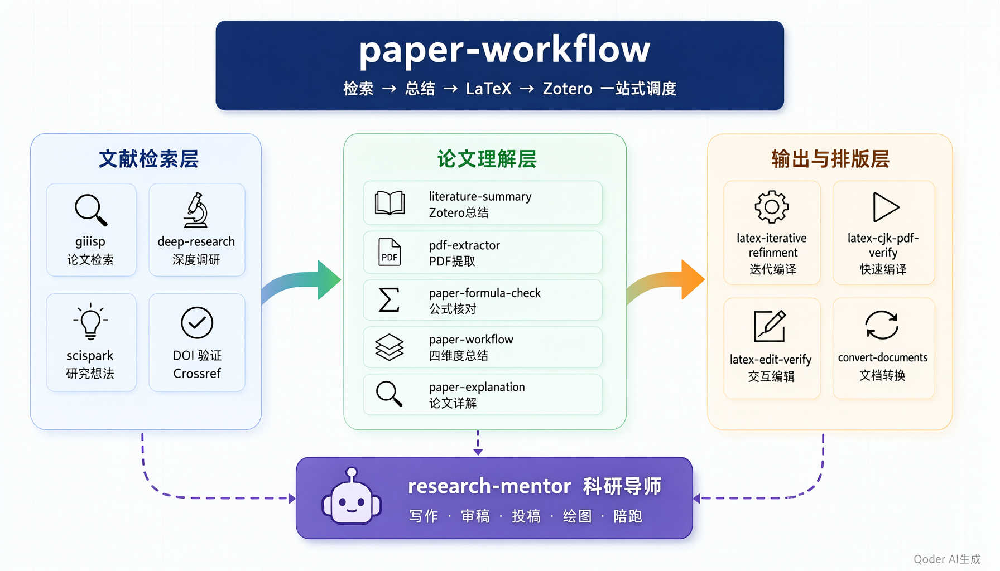
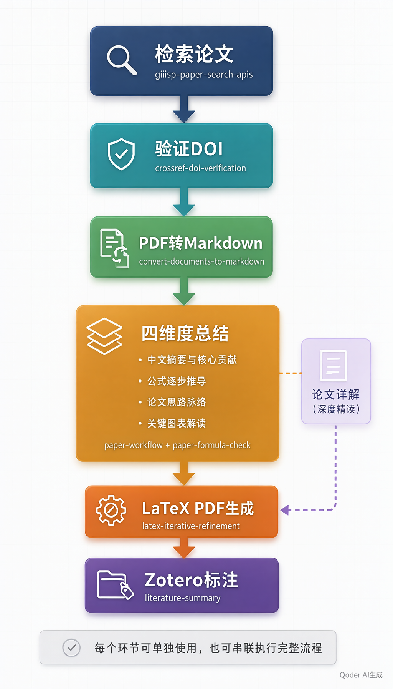
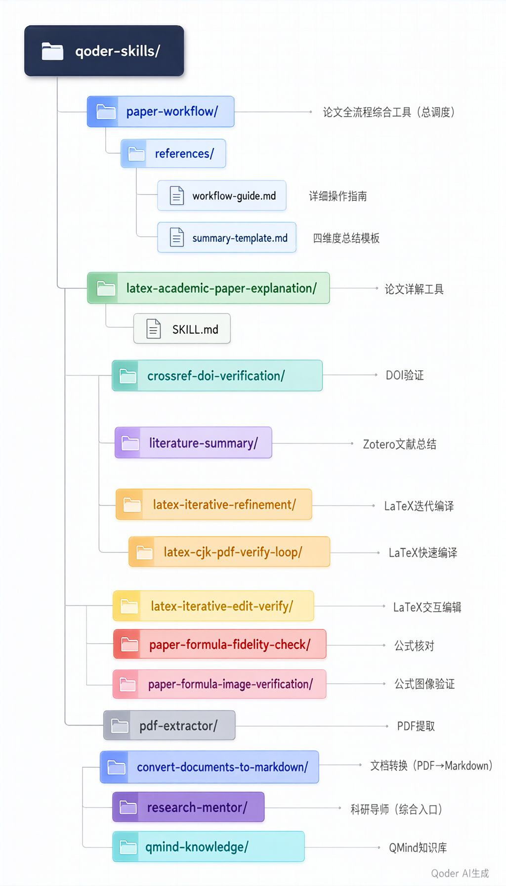

# 论文学习助手 · Skills 集合

> 一套面向科研工作者的 AI 技能体系，覆盖论文从检索、阅读、总结、写作到排版投稿的全流程。

[](#)
[](#)
[](#)

---

## 这是什么？

这是为 AI 编码助手打造的一套 **论文科研技能包**。每个 skill 是一个独立的能力模块，加载后就能在对应场景下自动触发，把通用 AI 变成你的专属科研助手。

**平台适配：**
- ✅ **Claude Code** — 原生支持，完整功能
- ✅ **OpenAI Codex** — 完全适配，使用 Codex Skill 系统
- ✅ **WorkBuddy** — 完全适配，工作流逻辑兼容

**适合谁用：** 研究生、博士生、科研工作者——尤其是控制理论、电子信息、自动化、计算机方向，但大部分技能对所有理工科通用。

---

## 技能全景图



> 三层架构：**文献检索层** → **论文理解层** → **输出与排版层**，由 `Paper Learning Assistant（论文学习助手）` 统一调度，`research-mentor` 作为综合入口覆盖写作、审稿、投稿、绘图全流程。

---

## 技能清单

### 核心工作流

| Skill | 一句话说明 | 触发词 |
|---|---|---|
| **Paper Learning Assistant（论文学习助手）** | 论文全流程综合工具（适配Codex/Claude/WorkBuddy）。检索→四维度总结→PDF转Markdown→LaTeX PDF→Zotero标注，一站式完成 | "总结论文""帮我读论文""论文工作流" |
| **latex_academic_paper_explanation** | 论文详解工具。深度解读单篇论文，生成六章结构LaTeX文档 | "论文详解""详细解读""整理成文档" |

### 文献检索与验证

| Skill | 一句话说明 | 触发词 |
|---|---|---|
| **crossref-doi-verification** | DOI 真实性验证。通过 Crossref + OpenAlex API 验证 DOI，获取摘要，绝不凭记忆编造 | "验证DOI""查DOI""参考文献审计" |
| **giiisp-paper-search-apis** | 集思谱论文检索。支持 OA 标题摘要检索和 arXiv 多字段检索 | "检索论文""找论文""文献初筛" |
| **sci-employee-deep-research** | 深度文献调研。系统性检索+关键词拆解+证据组织，输出可核验研究报告 | "深度调研""开题调研""文献综述" |

### 论文阅读与理解

| Skill | 一句话说明 | 触发词 |
|---|---|---|
| **literature-summary** | Zotero 文献总结。从 Zotero 提取 PDF → 结构化中文总结 → 导出 Word → 可选上传飞书 | "文献总结""paper summary" |
| **pdf-extractor** | PDF 内容提取。用 pdfplumber 提取文本、表格、图片，支持批量处理 | "提取PDF""PDF转文本" |
| **convert-documents-to-markdown** | 文档格式转换。Word/PPT/Excel/PDF → Markdown（基于 @firecrawl/anydoc） | "转换文档""PDF转Markdown""读取PDF" |
| **paper-formula-fidelity-check** | 公式逐条核对。以 PDF 渲染图为唯一权威，禁止 OCR 文本做符号级校验 | "公式不对""对照PDF检查公式" |
| **paper-formula-image-verification** | 公式图像验证。逐符号比对（分子分母、上下标、希腊字母），以图为准 | "核对公式""公式验证" |

### LaTeX 编译与排版

| Skill | 一句话说明 | 触发词 |
|---|---|---|
| **latex-iterative-refinement** | 迭代式编辑-编译-校验闭环。xelatex 编译 → 查错 → pdftoppm 渲染 → WPS 打开 | "编译并打开""检查排版""重新生成PDF" |
| **latex-cjk-pdf-verify-loop** | 中文 LaTeX 快速编译验证。两遍编译 + 可视化校验 + WPS 打开 | "编译tex""看看公式对不对" |
| **latex-iterative-edit-verify** | 聊天问答后写入 tex 的闭环。聊天中用 Unicode 数学，编辑后自动编译验证 | "放进去""补充进去""写进去" |

### 科研写作与投稿

| Skill | 一句话说明 | 触发词 |
|---|---|---|
| **research-mentor** | 科研导师。论文写作/重构/润色/审稿回复/投稿检查/科研绘图/研究生陪跑，29 个参考文件 | 几乎所有科研需求 |

---

## 快速开始

### 安装

```bash
# 克隆仓库
git clone https://github.com/zyj-cool/paper-learning-assistant.git

# 复制到对应平台的 skill 目录
# Claude Code:
cp -r paper-learning-assistant/* ~/.claude/skills/

# OpenAI Codex:
cp -r paper-learning-assistant/* ~/.codex/skills/

# WorkBuddy:
cp -r paper-learning-assistant/* ~/.workbuddy/skills/

# 或在对应平台中执行 reload 命令
```

### 典型使用场景

**场景 1：拿到一篇 PDF，快速总结**
```
你: 帮我总结这篇论文 [附PDF]
AI: [自动触发 Paper Learning Assistant（论文学习助手）]
  → convert-documents-to-markdown 转 Markdown + crossref 验证DOI
  → 四维度总结（摘要/公式/脉络/图表）
  → 生成LaTeX PDF
  → 标注Zotero标签
```

**场景 2：深度精读一篇论文**
```
你: 论文详解 [附PDF]
AI: [自动触发 latex_academic_paper_explanation]
  → 六章详解文档（概览/背景/方法/理论/实验/思考）
  → 编译为LaTeX PDF
  → WPS打开
```

**场景 3：检索某方向最新论文**
```
你: 帮我找几篇关于CBF多机器人避碰的最新论文
AI: [自动触发 giiisp-paper-search-apis]
  → 检索候选论文
  → 验证每篇DOI
  → 输出论文信息卡片
```

**场景 4：写论文时检查公式**
```
你: 这个符号不对，帮我对照PDF检查公式
AI: [自动触发 paper-formula-fidelity-check]
  → 渲染PDF页面为PNG
  → 逐符号比对
  → 标注差异类型
```

**场景 5：将 PDF 转为 Markdown**
```
你: 把这篇PDF转成Markdown
AI: [自动触发 convert-documents-to-markdown]
  → npx @firecrawl/anydoc paper.pdf -o paper.md
  → 输出 .md 文件
```

---

## 技能间的协作关系

这套技能不是孤立存在的，它们通过 `Paper Learning Assistant（论文学习助手）` 统一调度，形成完整闭环：



每个环节都可以**单独使用**，也可以**串联执行**。比如你可以只用 `crossref-doi-verification` 验证一个 DOI，也可以让 `Paper Learning Assistant（论文学习助手）` 自动走完整个流程。

---

## 设计原则

- **DOI 必须验证**：绝不凭记忆写 DOI，必须通过 Crossref API 验证
- **公式以图为准**：公式核对必须用 PDF 渲染图，不用 OCR 文本
- **编译用 xelatex**：中文文档必须用 xelatex，不用 pdflatex
- **WPS 打开 PDF**：编译后用 WPS 打开，不用系统默认阅读器
- **聊天用 Unicode**：对话中用 Unicode 数学符号，tex 文件中用 LaTeX 语法
- **PDF 转 Markdown 优先**：阶段2优先使用 `convert-documents-to-markdown`，失败时回退到 `pdf-extractor`

---

## 目录结构



---

## 更新日志

### 2026-10-24
- 新增 `Paper Learning Assistant（论文学习助手）`：论文全流程综合工具，四阶段工作流，适配 Codex/Claude/WorkBuddy
- 集成 `convert-documents-to-markdown`：PDF 转 Markdown 作为核心依赖
- 补全 `latex_academic_paper_explanation`：论文详解工具，六章深度解读
- 同步所有现有论文相关 skill 到仓库

---

## 版权与致谢

本 skill 集合的设计与实现借鉴、结合了以下来源：

- **网络公开 Skill**：参考了 开源社区、GitHub 上开源的 AI 编码助手 Skill 设计模式和工作流最佳实践
- **开源数据**：部分工作流逻辑和模板参考了 GitHub 上的开源论文处理工具、学术研究辅助项目和文档转换工具
- **API 服务**：集成了 Crossref、OpenAlex、Giiisp/集思谱、Firecrawl 等公开学术 API 和文档处理服务
- **社区贡献**：感谢各 AI 编码助手平台的开发者社区提供的 Skill 系统架构参考

本 skill 集合基于 **MIT 许可证** 开源。如引用内容涉及您的知识产权，请随时通过 [GitHub Issues](https://github.com/zyj-cool/paper-learning-assistant/issues) 或邮件联系，我们将及时修改或删除相关内容。

**作者**: zyj-cool  
**仓库**: https://github.com/zyj-cool/paper-learning-assistant  
**许可证**: MIT

---

## License

MIT
